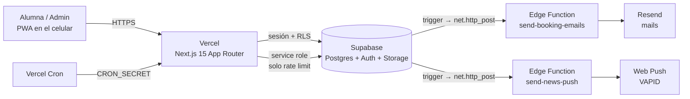

# 2 · TRD — Technical Requirements Document

**Producto:** un clu de bordado — app de reservas
**Estado:** en producción · octubre 2026

---

## 1. Arquitectura



| Capa | Tecnología | Responsabilidad |
|---|---|---|
| Frontend + servidor web | Next.js 15 (App Router), React 19, TypeScript | Páginas, server actions, route handlers, middleware |
| Datos y autenticación | Supabase (Postgres gestionado, Auth, Storage) | Esquema, reglas RLS, funciones de negocio, usuarios, fotos |
| Funciones de borde | Supabase Edge Functions (Deno) | Enviar mails y notificaciones push |
| Mail transaccional | Resend | Entrega de mails |
| Push | Web Push (VAPID) + service worker | Notificaciones al celular |
| Hosting | Vercel | Despliegue continuo desde `main`, variables, cron |

## 2. Versiones

| Paquete | Versión |
|---|---|
| next | 15.5.25 |
| react / react-dom | 19.0.0 |
| typescript | 5.6.x |
| tailwindcss | 3.4.x |
| @supabase/supabase-js | 2.114.x |
| @supabase/ssr | 0.12.x |
| zod | 3.23.x |
| react-hook-form + @hookform/resolvers | 7.53.x / 3.9.x |
| libphonenumber-js | 1.11.x |
| next-themes | 0.4.x |
| Node (desarrollo) | 20+ |

## 3. Decisiones técnicas clave

1. **La base es la fuente de verdad de las reglas.** Reservar y cancelar pasan por funciones `SECURITY DEFINER` (`book_slot`, `cancel_booking`); la UI solo refleja la regla. La reserva usa `UPDATE … WHERE booked_count < capacity`, por lo que dos personas no pueden tomar el último lugar.
2. **RLS en el 100 % de las tablas.** El navegador usa la clave pública; sin sesión, toda lectura sensible devuelve vacío.
3. **Roles protegidos por trigger.** `profiles_guard` impide que una usuaria cambie su `role`, `strikes` o `blocked`. El rol admin se asigna al registrarse con el email del dueño.
4. **Cliente con la sesión de la usuaria.** Las consultas de las páginas usan el cliente de servidor con cookies de sesión (RLS aplica). El cliente con `service_role` (`server-only`) se usa únicamente para el rate limiting.
5. **Notificaciones desacopladas por cola.** Un trigger inserta una fila en `email_events`; otro trigger llama a la Edge Function con un secreto compartido. El resultado (éxito o error) queda en la propia fila.
6. **Secretos fuera del código.** Variables de entorno en Vercel y Supabase; secretos de webhooks en `private.app_secrets` (sin permisos para `anon`/`authenticated`).

## 4. Autenticación y autorización

- **Supabase Auth**: email + contraseña, y Google OAuth (opcional, `NEXT_PUBLIC_GOOGLE_ENABLED`).
- **Sesión**: cookies gestionadas por `@supabase/ssr`; el middleware llama a `auth.getUser()` (valida contra el servidor, no confía en la cookie).
- **Rutas privadas**: `/calendario`, `/mis-reservas`, `/mi-perfil`, `/news`, `/reserva-kit`, `/completar-perfil`, `/admin/*`.
- **Admin en tres capas**: (1) middleware con `is_admin()`, (2) `requireAdmin()` en cada página y server action, (3) funciones/policies en la base con `is_admin()`.
- **Perfil completo obligatorio** (nombre y teléfono) para reservar; si falta, se redirige a `/completar-perfil`.

## 5. Seguridad

| Control | Detalle |
|---|---|
| RLS | 14 tablas con RLS; ver documento de esquema |
| Rate limiting (Postgres, `check_rate_limit`) | registro 5/h/IP · login 10/15 min/IP · reservar 12/h · cancelar 12/h · kit 6/h |
| Validación | `zod` en cliente y servidor; límites de longitud y cantidad |
| Cabeceras HTTP | `X-Frame-Options: DENY`, `X-Content-Type-Options: nosniff`, `Referrer-Policy`, `Permissions-Policy` |
| Cron | `/api/cron/*` exige `Authorization: Bearer CRON_SECRET` |
| Webhooks DB → Edge | Header con secreto leído de `private.app_secrets` |
| CSV | Se neutralizan celdas que empiezan con `=`, `+`, `-`, `@` |
| Entradas externas | Sin `dangerouslySetInnerHTML`; enlaces de noticias renderizados con un `linkify` propio |
| Secretos | `service_role` y claves de Resend/VAPID solo en servidor o Edge Functions |

## 6. Pipelines asíncronos

### Mails

```
INSERT/UPDATE en bookings | profiles | kit_orders
  → trigger enqueue_* → INSERT en email_events
  → trigger dispatch_email_event → net.http_post(send-booking-emails)
  → Resend → processed_at / error en email_events
```

Tipos: `booking_confirmed`, `booking_cancelled`, `user_registered`, `kit_reservation`, `birthday_month`, `monthly_report`.
Todos los mails se envían a `ADMIN_EMAIL` (la cuenta de Resend no tiene dominio verificado).

### Push

```
INSERT en news_posts → trigger dispatch_news_push → net.http_post(send-news-push)
  → web-push a cada fila de push_subscriptions (limpia endpoints caducados)
```

### Cron (Vercel)

| Ruta | Programación | Función |
|---|---|---|
| `/api/cron/birthdays` | día 1 de cada mes, 08:00 UTC | Encola avisos de cumpleaños del mes |
| `/api/cron/monthly-report` | todos los días 21:00 UTC | Solo actúa el último día del mes (hora de Madrid); idempotente por mes |

## 7. Internacionalización

- Idioma en cookie `lang` (`es` | `ca`); proveedor de contexto para componentes de cliente y `getT()` para servidor.
- El texto en español es la **clave** de traducción; el diccionario catalán está en `src/lib/i18n/ca.ts`. Si falta una clave, se muestra el español.
- Alcance: parte de alumnas. El layout de `/admin` fija el español; los mails son siempre en español.
- Fechas y nombres de país usan `Intl` con la configuración regional del idioma.

## 8. PWA

- `manifest.ts` (standalone, íconos any/maskable, atajos a calendario y reservas).
- Service worker `v3`: navegaciones network-first con `/offline.html`; estáticos stale-while-revalidate; nunca cachea `/api`, `/auth` ni Supabase.
- Prompt de instalación (Android y guía para iOS).
- Bloqueo con PIN: hash SHA-256 en `localStorage` del dispositivo; es una comodidad local, no autenticación.

## 9. Variables de entorno

| Variable | Dónde | Notas |
|---|---|---|
| `NEXT_PUBLIC_SUPABASE_URL` / `NEXT_PUBLIC_SUPABASE_ANON_KEY` | Vercel | Públicas |
| `NEXT_PUBLIC_SITE_URL` | Vercel | URL pública |
| `NEXT_PUBLIC_VAPID_PUBLIC_KEY` | Vercel | Pública |
| `NEXT_PUBLIC_GOOGLE_ENABLED` | Vercel | `"false"` oculta Google |
| `SUPABASE_SERVICE_ROLE_KEY` | Vercel (Sensitive) | Solo servidor |
| `CRON_SECRET` | Vercel (Sensitive) | Protege los cron |
| `RESEND_API_KEY`, `RESEND_FROM`, `ADMIN_EMAIL`, `EMAIL_WEBHOOK_SECRET`, `SITE_URL` | Supabase (secrets de Edge Functions) | Mails |
| `VAPID_PUBLIC_KEY`, `VAPID_PRIVATE_KEY`, `VAPID_SUBJECT`, `PUSH_WEBHOOK_SECRET` | Supabase (secrets de Edge Functions) | Push |

> Los secrets de Edge Functions son por proyecto. Cambiar uno requiere **redesplegar** la función.

## 10. Despliegue y operación

- **Código**: push a `main` → Vercel construye y publica. El build debe pasar `tsc` y `next build`.
- **Base de datos**: migraciones en `supabase/migrations/`, aplicadas en orden desde el SQL Editor (no hay CLI enlazada). `supabase/ALL_MIGRATIONS.sql` es la concatenación.
- **Edge Functions**: se pegan y despliegan desde el dashboard de Supabase.
- **Observabilidad**: `email_events.error`, logs de Vercel y de Edge Functions.
- **Respaldos**: los de Supabase; no hay exportación programada propia.

## 11. Deuda técnica y riesgos

| Ítem | Impacto | Mitigación |
|---|---|---|
| Sin tests automatizados | Regresiones se detectan a mano | Plan en el documento 6 |
| Mails limitados a la admin | Alumnas sin confirmación por mail | Verificar un dominio propio en Resend |
| `booked_count` es un contador mantenido por funciones | Puede desfasarse si se edita a mano | Siempre reservar/cancelar por las funciones |
| Un solo admin, sin auditoría | Poca trazabilidad | Registro de acciones admin (futuro) |
| Aviso de `postcss` en `npm audit` | Sin explotación posible en el caso de uso | Actualizar a Next 16 cuando convenga |
| Migraciones aplicadas a mano | Posible olvido entre entornos | Enlazar la CLI de Supabase |
