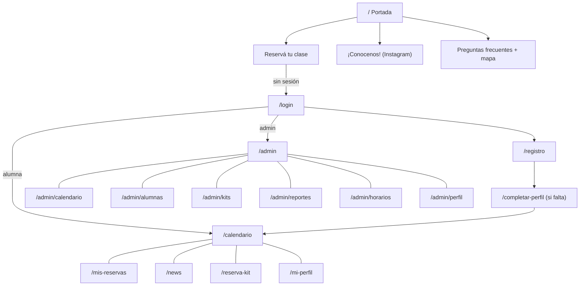
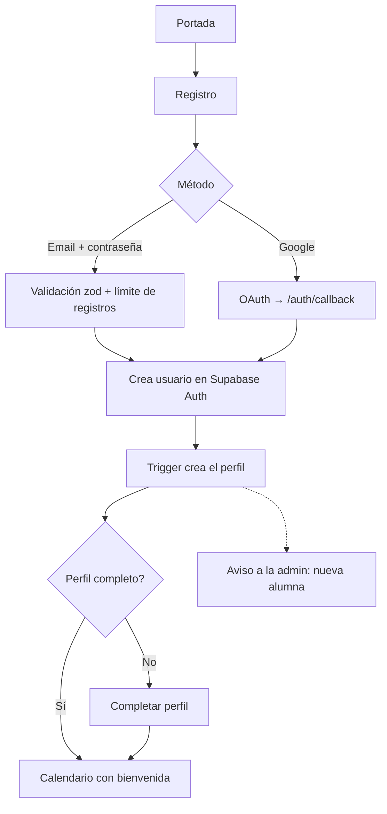
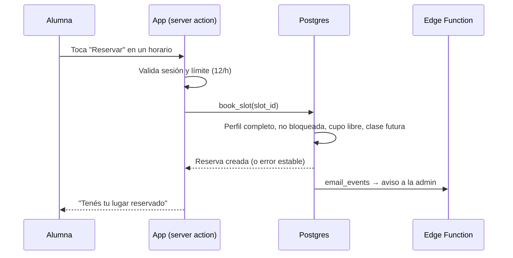
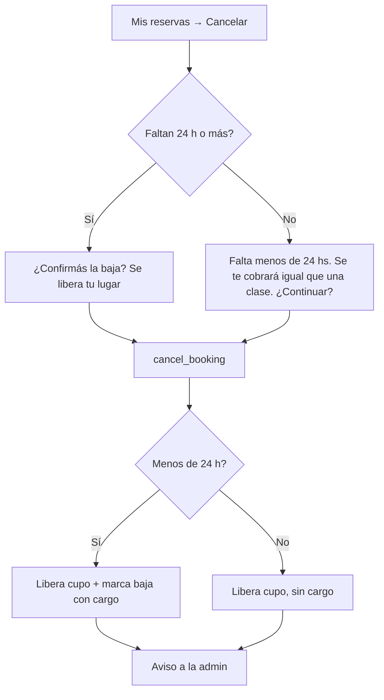
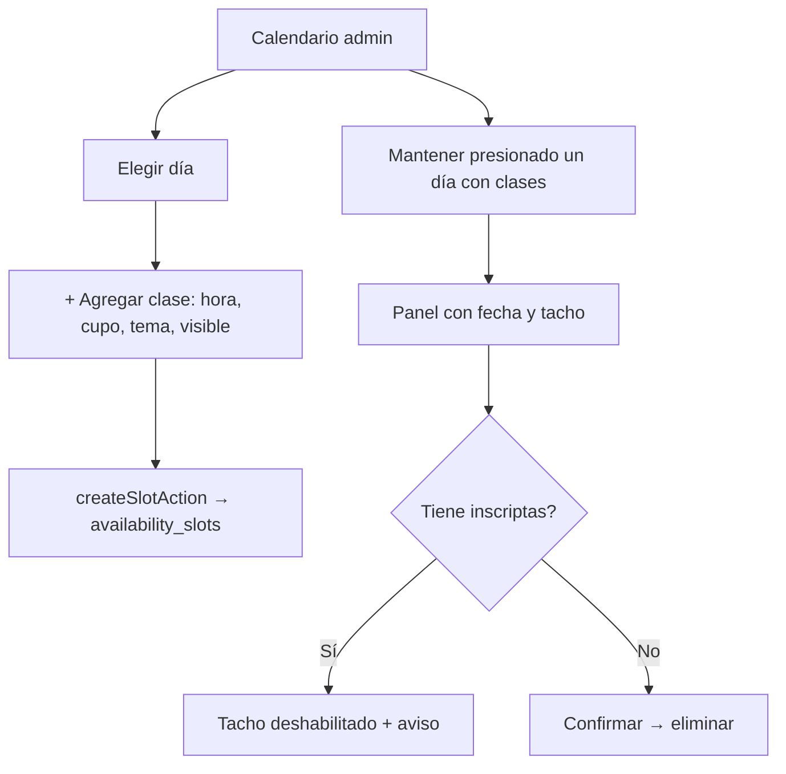
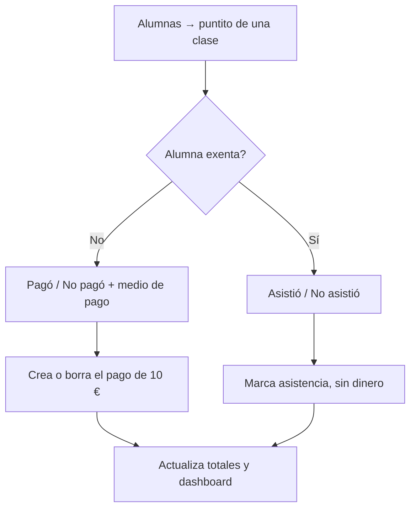
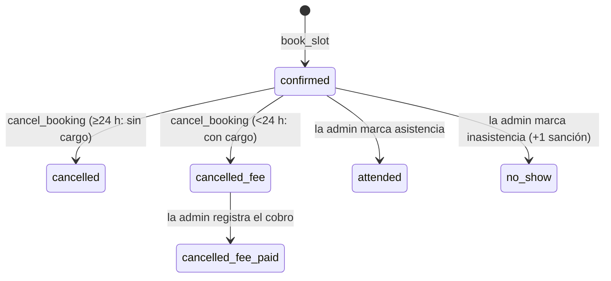

# 4 · App Flow

**Producto:** un clu de bordado — app de reservas
Este documento describe cómo se mueven las personas por la app y qué pasa por detrás en cada paso.

---

## 1. Mapa de navegación

**Redirecciones automáticas**

| Situación | Destino |
|---|---|
| Ruta privada sin sesión | `/login?next=<ruta>` |
| Sesión sin nombre o teléfono | `/completar-perfil` |
| Admin entra a `/calendario` o `/mis-reservas` | `/admin/calendario` o `/admin` |
| No-admin entra a `/admin` | `/calendario` |
| Sesión activa en `/login` o `/registro` | `/calendario` (o la ruta `next`) |

## 2. Flujos de la alumna

### 2.1 Alta y primer ingreso

1. La alumna elige idioma (ES/CAT) en la portada, si lo necesita.
2. Completa nombre y apellido, teléfono (con país), nacimiento, email y contraseña.
3. Si el proyecto exige confirmar email, ve "Revisá tu correo"; si no, entra directo.
4. Se crea el perfil por trigger; la admin recibe el aviso de alta.

### 2.2 Reservar una clase

Errores posibles y su mensaje: perfil incompleto, cuenta bloqueada, ya reservada, clase llena, clase pasada, demasiados intentos.

### 2.3 Cancelar una reserva

La baja tardía **no** suma sanción: solo se cobra la clase (10 €) en la próxima visita.

### 2.4 Pedir un kit

1. `Reservá tu kit` → elige modelo, cantidad (1–20) y nota opcional (300 caracteres).
2. La app valida sesión, kit y límite (6/h) e inserta en `kit_orders`.
3. Un trigger encola el aviso; la admin recibe nombre, teléfono, email, kit y nota.
4. La admin coordina entrega y pago en persona.

### 2.5 Noticias y notificaciones

1. `News` muestra el feed; el punto rojo en la barra indica novedades sin leer.
2. La alumna puede activar notificaciones (permiso del navegador + suscripción push).
3. Puede reaccionar con ❤️ 😊 😂 😢 (una reacción por noticia).

### 2.6 Preguntas frecuentes y ubicación

Portada → "Preguntas frecuentes" → lista de 6 preguntas → al tocar una se despliega; "¿Dónde queda?" incluye zonas, metro, buses y mapa de Google con enlace "Abrir en Google Maps".

## 3. Flujos de la admin

### 3.1 Agendar y eliminar clases

La eliminación se verifica contra la tabla real de reservas (no contra el contador).

### 3.2 Asistencia y cobro

Para una baja con cargo (punto amarillo), la admin marca si ya la cobró; si la alumna es exenta, no hay cobro posible.

### 3.3 Pedidos de kit

1. Dashboard o `Kits` → lista de pedidos pendientes y en curso.
2. Contacta por teléfono, WhatsApp o mail directamente desde la tarjeta.
3. Cambia el estado: `Ya la contacté` → `Entregada`, o `Cancelar`.
4. Lo cerrado pasa al historial plegable.

### 3.4 Gestión de alumnas

- Marcar o quitar **exención de pago** (la lista muestra "EXENTA" mientras esté activa).
- Ver y perdonar **sanciones**; el bloqueo se activa solo a las 3.
- Registrar una **inasistencia** manualmente.

### 3.5 Reportes y exportación

- **Reporte mensual**: automático el último día del mes; llega por mail y se ve en `Reportes`.
- **Exportar**: selector de mes o "Todos los meses" → descarga CSV (abre con Excel).

### 3.6 Publicar una noticia

Composer en `News` → Publicar → trigger → push a todas las suscriptas.

## 4. Flujos automáticos

| Disparador | Qué ocurre |
|---|---|
| Nueva reserva | Aviso a la admin |
| Cancelación | Aviso a la admin con si fue tardía y si se cobra |
| Alta de alumna | Aviso a la admin |
| Pedido de kit | Aviso a la admin con contacto y detalle |
| Día 1 de cada mes | Aviso de cumpleaños del mes |
| Último día del mes | Reporte mensual por mail |
| Noticia publicada | Push a las suscriptas |

## 5. Estados de una reserva

(`cancelled_fee` = `status = cancelled` con `penalty_fee = true`.)
