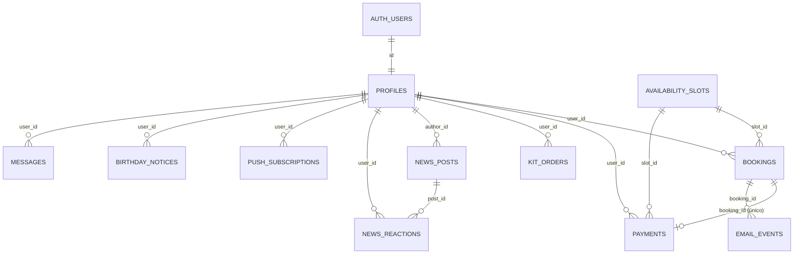

# 5 · Backend Schema

**Producto:** un clu de bordado — app de reservas
**Motor:** PostgreSQL gestionado por Supabase · esquemas `public`, `private`, `auth` (Supabase), `storage` (Supabase)
**Fuente de verdad:** `supabase/migrations/` (30 migraciones). `supabase/ALL_MIGRATIONS.sql` es su concatenación.

---

## 1. Diagrama de relaciones

## 2. Tablas

### `public.profiles`
Una fila por usuaria de Auth (alumna o admin).

| Columna | Tipo | Notas |
|---|---|---|
| `id` | uuid PK | = `auth.users.id`, `on delete cascade` |
| `full_name` | text | default `''` |
| `phone_e164` | text | default `''`; formato `+[1-9][0-9]{6,14}` o vacío |
| `role` | text | `alumna` \| `admin` (default `alumna`) |
| `strikes` | smallint | ≥ 0; sanciones por inasistencia |
| `blocked` | boolean | `true` a las 3 sanciones |
| `birth_date` | date | nullable |
| `avatar_url` | text | nullable |
| `notifications_enabled` | boolean | default `true` |
| `payment_exempt` | boolean | default `false`; alumna que nunca genera cobro |
| `news_last_seen_at` | timestamptz | para el punto rojo de News |
| `created_at`, `updated_at` | timestamptz | trigger de `updated_at` |

### `public.availability_slots`
Clases publicadas por la admin.

| Columna | Tipo | Notas |
|---|---|---|
| `id` | uuid PK | |
| `class_date` | date | |
| `start_time`, `end_time` | time | `end_time > start_time` |
| `capacity` | smallint | 1–6 (default 6) |
| `booked_count` | smallint | ≥ 0 y ≤ `capacity`; mantenido por `book_slot`/`cancel_booking` |
| `notes` | text | tema opcional |
| `is_published` | boolean | default `true` |
| `created_by` | uuid FK → profiles | `on delete set null` |
| `created_at`, `updated_at` | timestamptz | |

Único: `(class_date, start_time)`. Índices por fecha y por "reservable".

### `public.bookings`

| Columna | Tipo | Notas |
|---|---|---|
| `id` | uuid PK | |
| `slot_id` | uuid FK → availability_slots | `on delete cascade` |
| `user_id` | uuid FK → profiles | `on delete cascade` |
| `status` | text | `confirmed` \| `cancelled` |
| `late_cancellation` | boolean | baja con menos de 24 h |
| `penalty_fee` | boolean | baja con cargo (la clase se cobra) |
| `no_show` | boolean | inasistencia marcada por la admin |
| `attended` | boolean | nullable: `true`/`false`/sin marcar |
| `created_at`, `cancelled_at` | timestamptz | |
| `cancelled_by` | uuid FK → profiles | |

Único parcial: una reserva `confirmed` por `(slot_id, user_id)`.

### `public.payments`

| Columna | Tipo | Notas |
|---|---|---|
| `id` | uuid PK | |
| `user_id` | uuid FK → profiles | cascade |
| `slot_id` | uuid FK → availability_slots | `set null` |
| `booking_id` | uuid FK → bookings | **único**; un pago por reserva |
| `amount` | numeric(10,2) | normalmente 10 |
| `method` | text | `efectivo` \| `bizum` \| `transferencia` |
| `paid_on` | date | default hoy (Madrid) |
| `note`, `created_by`, `created_at` | | |

### `public.kit_orders`

| Columna | Tipo | Notas |
|---|---|---|
| `id` | uuid PK | |
| `user_id` | uuid FK → profiles | cascade |
| `kit` | text | `basico` \| `medium` \| `pro` |
| `quantity` | smallint | 1–20 |
| `note` | text | |
| `status` | text | `pendiente` \| `contactada` \| `entregada` \| `cancelada` |
| `created_at` | timestamptz | |

### `public.kits`
Catálogo editable. `id` (`basico`/`medium`/`pro`), `name`, `tagline`, `items` (jsonb, array de textos), `price_eur`, `photo_url`, `sort_order`, `updated_at`.

### `public.news_posts` y `public.news_reactions`
- `news_posts`: `id` (identity), `author_id`, `title` (1–160), `body` (1–4000), `created_at`.
- `news_reactions`: PK `(post_id, user_id)`, `emoji` ∈ `like|feliz|risa|triste`.

### `public.push_subscriptions`
`id`, `user_id`, `endpoint` (único), `p256dh`, `auth`, `created_at`.

### `public.email_events`
Cola de notificaciones: `id`, `type` (`booking_confirmed`, `booking_cancelled`, `user_registered`, `birthday_month`, `kit_reservation`, `monthly_report`), `booking_id`, `payload` (jsonb), `processed_at`, `error`, `created_at`.

### `public.rate_limits`
`id`, `bucket`, `subject`, `created_at` — ventana deslizante usada por `check_rate_limit`.

### `public.birthday_notices`
PK `(user_id, ym)`: evita enviar dos veces el aviso de cumpleaños del mismo mes.

### `public.messages` *(sin pantalla activa)*
`id`, `user_id`, `body` (1–2000), `created_at`. Quedó de una sala de chat no lanzada.

### `private.app_secrets`
`key` PK, `value`, `updated_at`. Guarda los secretos de webhooks; **sin permisos** para `anon`/`authenticated`, solo leída por funciones `SECURITY DEFINER`.

### Storage
Bucket público `avatars`: lectura pública; cada usuaria escribe solo en la carpeta de su propio `uid`.

## 3. Seguridad a nivel de fila (RLS)

RLS activo en las 14 tablas.

| Tabla | Lectura | Escritura |
|---|---|---|
| `profiles` | La propia o admin | Insert propio; update propio o admin. `profiles_guard` impide cambiar `role`, `strikes`, `blocked` a no-admin |
| `availability_slots` | Publicadas, o admin | Solo admin |
| `bookings` | Las propias o admin | **Ninguna directa**: solo vía funciones |
| `payments` | Solo admin | Solo admin |
| `kit_orders` | Propios o admin | Insert propio (con perfil completo); update solo admin |
| `kits` | Cualquier usuaria autenticada | Solo admin |
| `news_posts` | Autenticadas | Solo admin |
| `news_reactions` | Autenticadas | Solo la propia |
| `push_subscriptions` | Solo la propia | Solo la propia |
| `email_events` | Solo admin | Solo triggers/servicio |
| `rate_limits`, `birthday_notices`, `private.app_secrets` | Sin policies (solo funciones/servicio) | idem |
| `messages` | Autenticadas | Insert propio |

## 4. Funciones (RPC y utilitarias)

### Alumna
| Función | Qué hace |
|---|---|
| `book_slot(p_slot_id)` | Reserva atómica: valida sesión, perfil completo, no bloqueada, clase futura, no duplicada y cupo |
| `cancel_booking(p_booking_id)` | Cancela; libera cupo; con menos de 24 h marca `penalty_fee` y `late_cancellation` (sin sanción) |
| `news_feed(p_limit)` | Noticias con conteos de reacciones y reacción propia |
| `birthdays_in_month(p_year, p_month)` | Cumpleaños del mes (alumnas y admin) |
| `is_admin()` | Helper usado por policies y funciones |

### Admin
| Función | Qué hace |
|---|---|
| `admin_students_overview(p_from, p_to)` | Alumnas con reservas del rango, estado de pago y `payment_exempt` |
| `admin_toggle_paid(p_booking_id, p_paid, p_method)` | Marca asistencia y crea/borra el pago; si es exenta, solo asistencia |
| `admin_toggle_penalty_paid(...)` | Cobra/descobra una baja tardía (rechaza exentas) |
| `admin_set_booking_status(...)` | Asistencia y pago en una sola llamada |
| `mark_no_show(p_booking_id)` / `reset_strikes(p_user_id)` | Inasistencia (+1 sanción, bloqueo a las 3) / perdón |
| `admin_kit_orders()` | Pedidos de kit con nombre, teléfono y email |
| `admin_month_totals`, `admin_month_summary`, `admin_income_total`, `admin_students_by_month`, `admin_upcoming_birthdays` | Métricas del dashboard |
| `admin_rosters_between`, `admin_list_students`, `admin_student_detail`, `admin_student_payments` | Listados y detalle |
| `record_payment`, `delete_payment` | Alta y baja manual de pagos |

### Sistema
| Función | Qué hace |
|---|---|
| `check_rate_limit(bucket, subject, max, window)` | Solo `service_role`; devuelve si el intento está permitido |
| `enqueue_booking_email`, `enqueue_registration_email`, `enqueue_kit_email` | Triggers que insertan en `email_events` |
| `enqueue_birthday_month_notices()` | Cron mensual de cumpleaños |
| `enqueue_monthly_report()` | Reporte mensual, idempotente por mes |
| `dispatch_email_event`, `dispatch_news_push` | Llaman a las Edge Functions con secreto |
| `dispatch_kit_whatsapp` | **Inactivo**: no hace nada sin secreto (WhatsApp descartado) |
| `handle_new_user` | Crea el perfil al registrarse; asigna rol admin al email del dueño |
| `profiles_guard`, `set_updated_at`, `touch_updated_at` | Protección y marcas de tiempo |

## 5. Triggers

| Trigger | Tabla | Efecto |
|---|---|---|
| `on_auth_user_created` | `auth.users` | Crea el perfil |
| `profiles_guard_trg` | `profiles` | Bloquea cambios de rol/sanciones por no-admin |
| `profiles_registration_email_ins/upd` | `profiles` | Encola aviso de alta |
| `bookings_email_insert` / `bookings_email_cancel` | `bookings` | Encola aviso de reserva / cancelación |
| `kit_orders_email` | `kit_orders` | Encola aviso de pedido de kit |
| `kit_orders_whatsapp` | `kit_orders` | Inactivo |
| `email_events_dispatch` | `email_events` | Llama a `send-booking-emails` |
| `news_posts_push` | `news_posts` | Llama a `send-news-push` |
| `*_set_updated_at`, `kits_touch_updated_at` | varias | Mantienen `updated_at` |

## 6. Edge Functions

| Función | Entrada | Salida |
|---|---|---|
| `send-booking-emails` | Fila de `email_events` + header de secreto | Mail por Resend a `ADMIN_EMAIL`; marca `processed_at` o `error` |
| `send-news-push` | Noticia + header de secreto | Push a cada suscripción; elimina endpoints caducados |

## 7. Tareas programadas

| Ruta (Vercel Cron) | Cuándo | Llama a |
|---|---|---|
| `/api/cron/birthdays` | Día 1 de cada mes, 08:00 UTC | `enqueue_birthday_month_notices()` |
| `/api/cron/monthly-report` | Diario 21:00 UTC (actúa solo el último día del mes en Madrid) | `enqueue_monthly_report()` |

## 8. Reglas de integridad importantes

1. Un pago por reserva (`payments.booking_id` único).
2. Una reserva activa por alumna y clase.
3. El cupo nunca supera `capacity` (constraint + `UPDATE` condicional).
4. Eliminar una clase borra sus reservas en cascada, por eso la app solo lo permite si no existen reservas.
5. Borrar un usuario de Auth borra su perfil, reservas, pedidos y suscripciones.
6. `payment_exempt` + `attended = true` cuenta como "cobrada" en pantalla, **sin** fila en `payments` y sin sumar a ingresos.
